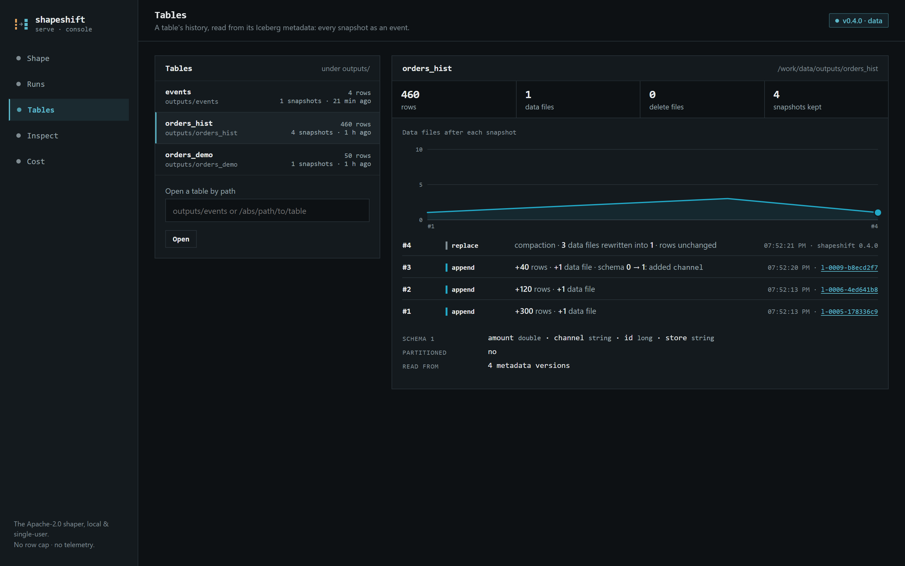
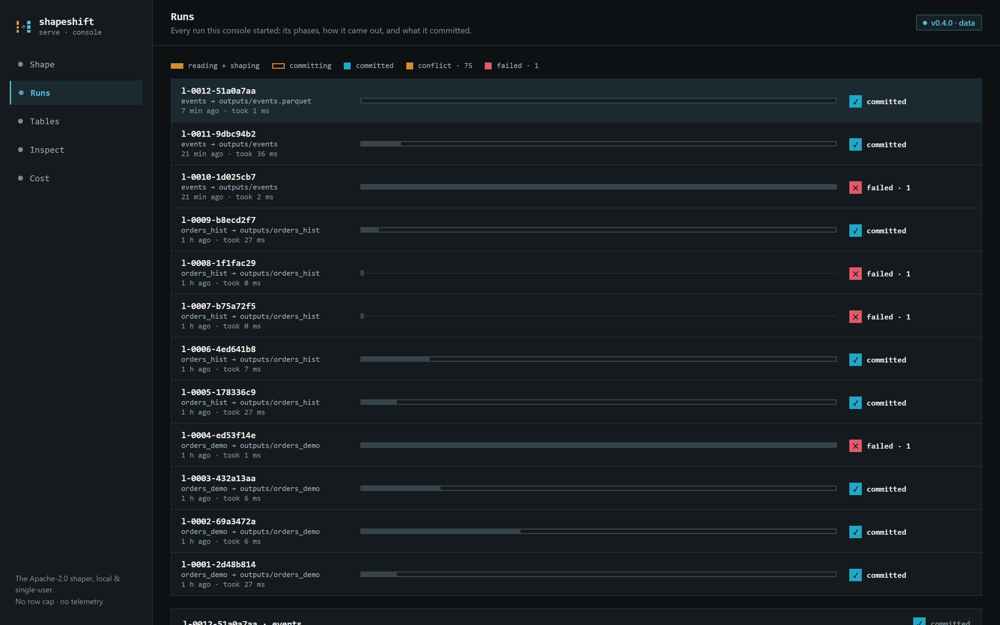
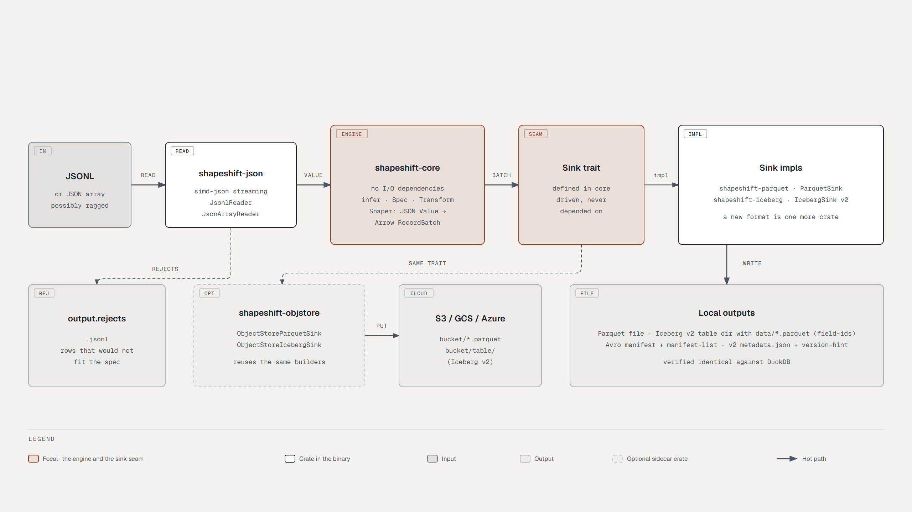
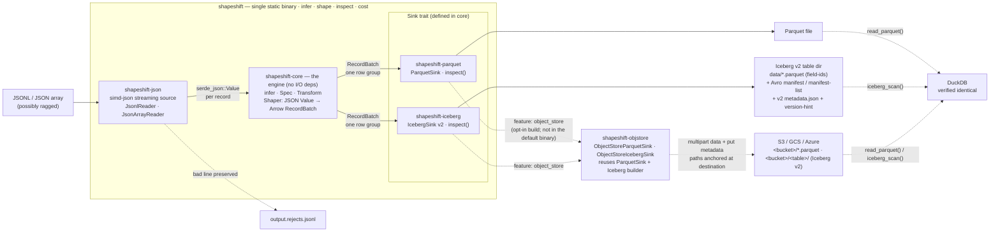
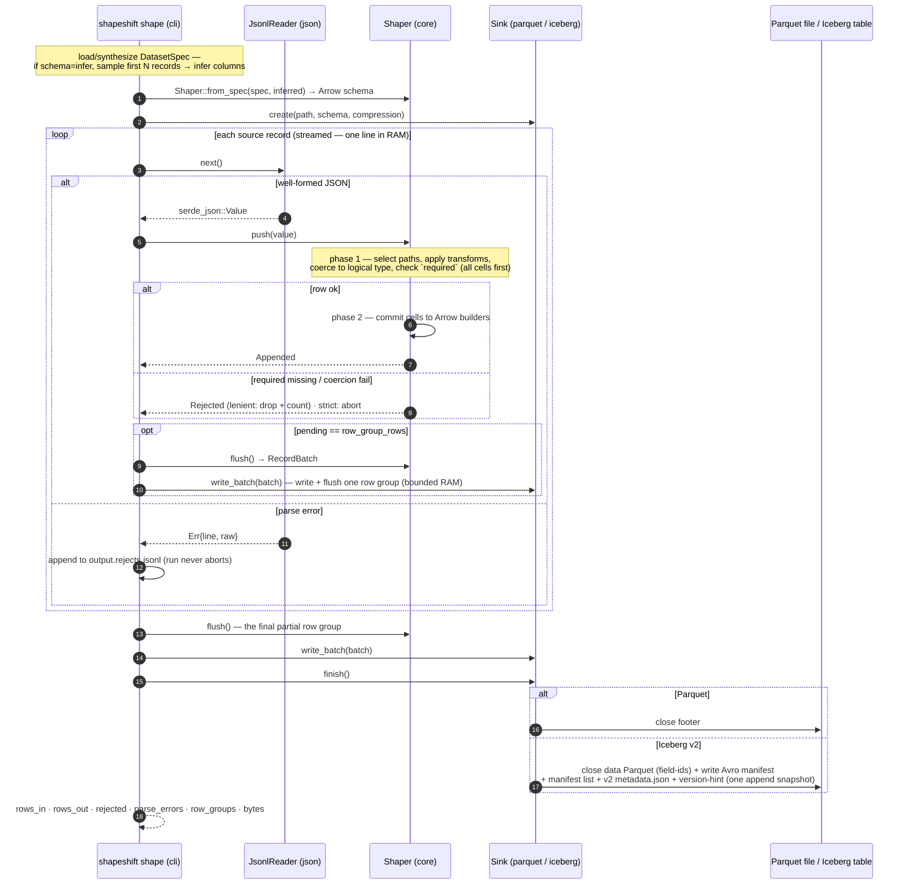

# shapeshift

**shapeshift** streams JSON/JSONL into **Parquet** or an **Apache Iceberg v2** table under a small
declarative *dataset transform spec*. Write one spec per source *shape* — the columns, types, and
value transforms your rows need — then shape unbounded rows on your own hardware for the cost of the
CPU that does it. It is a single static **Apache-2.0** Rust binary (or an embeddable set of crates):
no JVM, no catalog server, no Python, no row cap, no telemetry. It is the honest answer to per-row
(MAR) billing — the shaping **data-plane**, and nothing else.

[](LICENSE)
[](https://github.com/lucheeseng827/shapeshift/releases)
[](https://hub.docker.com/r/mancube/shapeshift)
[](https://hub.docker.com/r/mancube/shapeshift)
[](https://hub.docker.com/r/mancube/shapeshift)

**Status: released.** The current release is **0.5.0**. Each tagged release publishes:
- a static `shapeshift` binary for Linux x86_64 (musl), with its SHA-256, on the
  [release page](https://github.com/lucheeseng827/shapeshift/releases);
- the multi-arch image (`linux/amd64`, `linux/arm64`) `mancube/shapeshift`, tagged with
  the version and `latest`: the same static binary on `scratch`.

Website and docs: [shapeshift.mancube.net](https://shapeshift.mancube.net/).

## See it in action

`shapeshift serve` is a local web console in the same binary: infer and edit a spec, shape,
inspect, and see every run and every table's history (the Runs and Tables views are new
in 0.5). Click a screenshot to enlarge it; [Serve](#serve--a-local-web-console) says how to
start it.

| Tables — a table's history as events, with the data files after each snapshot | Runs — every run as its phases and how it came out |
|---|---|
| [](docs/images/console-tables.png) | [](docs/images/console-runs.png) |

- **Tables:** a table taken through three appends (the third adds a column) and a compaction. The
  local tables are listed on the left. On the right are the table's figures, its data files after
  each snapshot, the events newest first (each linked to the run that wrote it) and the current
  schema.
- **Runs:** one row per run, newest first. Each shows its id, dataset and output, a bar for its
  phases, and how it came out (committed, conflict 75, failed 1).

## Performance — measured, not claimed

Every figure here comes from the reproducible harness in [`benchmarks/`](./benchmarks/)
(python3 stdlib and cargo, no other dependencies; per-child `ru_maxrss`), on **one stated
machine**. They are evidence that the design holds, not a promise about yours: run the harness on
your hardware. The details and every A/B are in [BENCHMARKS.md §7](./BENCHMARKS.md#7-performance-measured).

| | |
|---|---|
| **14.1 MiB** peak RSS | shaping a 1,260 MB input (8 million rows) |
| **~820×** input growth | across the sweep, for a 1.4× move in peak memory (9.9 → 14.1 MiB) |
| **~260–275k rows/s** | steady from 1M to 8M rows on the shipped musl-static binary, Parquet and Iceberg alike |
| **3.0 ms** cold start | median, exec to four rows shaped to exit: no JVM, no interpreter, no warm-up |

| bench | rows | input | wall | rows/s | peak RSS |
|---|---|---|---|---|---|
| jsonl→parquet | 10,000 | 1.5 MB | 0.06 s | 157,980 | 9.9 MiB |
| jsonl→iceberg | 10,000 | 1.5 MB | 0.06 s | 163,567 | 9.9 MiB |
| jsonl→parquet | 1,000,000 | 157 MB | 3.85 s | 259,769 | 12.3 MiB |
| jsonl→iceberg | 1,000,000 | 157 MB | 3.84 s | 260,646 | 12.4 MiB |
| jsonl→parquet | 8,000,000 | 1,260 MB | 29.3 s | 273,495 | **14.1 MiB** |
| jsonl→iceberg | 8,000,000 | 1,260 MB | 29.7 s | 269,506 | **14.1 MiB** |

*Machine: Intel Xeon @ 2.80 GHz (4 cores), 15.7 GiB RAM · rustc 1.94.1 · the shipped musl-static
binary (~4.0 MB, stripped).*

Memory is bounded by the row group, not the input: the shaper flushes a batch every
`row_group_rows` (default 50,000) and the sink closes that row group at once. (The sweep writes
an unpartitioned table. A partitioned write closes each row group at once too, and also keeps one
file and its statistics open per partition value it has seen.) **The unflattering
half:** the same engine built against glibc is about 1.34× faster (367k rows/s at 8M rows), and
its peak RSS appears to grow with the input (67 MiB at 8M rows) because glibc's malloc keeps freed
buffers. That is retention, not a leak. Pick the binary by what you are optimising for.

Tables that take updates (0.3 and 0.4), measured on a 4 vCPU Intel Xeon @ 2.10 GHz with a glibc
build and DuckDB 2.0 as the reader:

| | |
|---|---|
| **0.37 s** | merging 100,000 rows, half of them updates, into a 1M-row table (appending them: 0.14 s) |
| **71 → 9 ms** | a DuckDB scan after 30 daily merges, then after one 0.72 s `compact` (before any merge: 7 ms) |
| **27.1 → 10.3 MiB** | the same table on disk, compacted with its history, then after `expire` |
| **exit 75** | a writer the commit guard refused: nothing it wrote was published, run it again |

## The gap

Managed ELT — Fivetran and its peers — bills by **MAR (Monthly Active Rows)**: every distinct
primary key inserted, updated, or deleted in a month, priced on a steep tiered curve. Re-touching the
same rows pays again. Fanning one source into several datasets pays again. The bill tracks *row
activity*, not the compute that moved the bytes, so a chatty upstream can dwarf the actual work.

Meanwhile the **Iceberg-Rust write path is now production-ready**, so a single static Rust binary can
land governed lakehouse tables — Parquet data files, Avro manifests, JSON table metadata — with no JVM
and no catalog server in the loop. shapeshift shapes the same rows a managed connector would bill you
for, at CPU cost, and writes them straight into the columnar/lakehouse formats your query engine
already reads. You keep the data locality; you keep the money.

## Quickstart

A real, copy-pasteable session against the shipped [`examples/events.jsonl`](./examples/events.jsonl)
(four good records — one line is deliberately not JSON):

```sh
# 1. Infer a spec from a sample and print a ready-to-edit YAML DatasetSpec.
$ shapeshift infer -i examples/events.jsonl
dataset: events
source:
  format: jsonl
  path: examples/events.jsonl
output:
  format: parquet
  path: events.parquet
  compression: snappy
schema: infer
columns:
- name: active
  type: bool
  required: false
- name: amount
  type: float64
  required: false
- name: day
  type: date          # YYYY-MM-DD detected → DATE
  required: false
- name: event_at
  type: timestamp     # RFC3339 detected → TIMESTAMP(µs)
  required: false
- name: id
  type: int64
  required: false
- name: tags
  type: json          # arrays become a JSON-encoded string leaf
  required: false
- name: user.name     # nested objects flatten to dotted columns
  type: string
  required: false
- name: user.plan
  type: string
  required: false
options:
  flatten: true
  row_group_rows: 50000
  infer_sample: 1000
```

```sh
# 2. Shape it. With no --spec, shapeshift infers on the fly (so --input and --output are required).
$ shapeshift shape --input examples/events.jsonl --output events.parquet
shaped `events` → events.parquet (Parquet)
rows_in=4 rows_out=4 rejected=0 parse_errors=1 row_groups=1 bytes=2588
malformed / rejected rows → events.parquet.rejects.jsonl (1 parse, 0 shaped-out)
```

The run never aborts on a bad line. The one non-JSON line was **counted** (`parse_errors=1`) and its
raw text was **sidecarred** to `events.parquet.rejects.jsonl`, one JSON object per line
(`line` / `error` / `raw`):

```json
{"error":"ExpectedNull at character 0 ('n')","line":4,"raw":"not-json-a-bad-line"}
```

It composes in a pipeline too — `-` is standard input, and the source is read once, so a
pipe shapes exactly what a file would:

```sh
$ cat examples/events.jsonl | shapeshift shape -i - -o events.parquet
shaped `stdin` → events.parquet (Parquet)
rows_in=4 rows_out=4 rejected=0 parse_errors=1 row_groups=1 bytes=2588
```

```sh
# 3. Inspect the Parquet file (footer only — no data scan).
$ shapeshift inspect events.parquet
parquet file: events.parquet
  rows: 4
  row-groups: 1
  columns (8):
    active: Boolean
    amount: Float64
    day: Date32
    event_at: Timestamp(Microsecond, None)
    id: Int64
    tags: Utf8
    user.name: Utf8
    user.plan: Utf8
```

```sh
# 4. Same input, same spec, but land an Apache Iceberg v2 table directory instead.
$ shapeshift shape --input examples/events.jsonl --output events_tbl --to iceberg
shaped `events` → events_tbl (Iceberg)
rows_in=4 rows_out=4 rejected=0 parse_errors=1 row_groups=1 bytes=3212
malformed / rejected rows → events_tbl.rejects.jsonl (1 parse, 0 shaped-out)
iceberg table metadata → events_tbl/metadata/v1.metadata.json

$ shapeshift inspect events_tbl
iceberg table: events_tbl
  format-version: 2
  table-uuid: 863152cb-5515-4e65-ae68-233cf2449571
  current-snapshot-id: 2060351657693168789
  total-records: 4
  columns (8):
    active: boolean
    amount: double
    day: date
    event_at: timestamp
    id: long
    tags: string
    user.name: string
    user.plan: string
```

The table is self-contained — no catalog server needed:

```text
events_tbl/
  data/<uuid>.parquet                          # data, carrying PARQUET:field_id 1..N
  metadata/<uuid>-m0.avro                       # manifest (field-id-carrying Avro schema)
  metadata/snap-<snapshot-id>-1-<uuid>.avro     # manifest list
  metadata/v1.metadata.json                     # table metadata
  metadata/version-hint.text
```

**Verified readable by DuckDB 1.5.4.** `read_parquet('events.parquet')` returns the four rows with
correct types, dates/timestamps, flattened columns, and nulls; `iceberg_scan('events_tbl')` returns
the *same* rows and the *same* aggregates end-to-end — verified identical to the Parquet path
(4 rows, `sum(amount)=115.49`).

## The dataset transform spec

The spec is the **product boundary**: write it once per source shape, then shape unbounded rows for
free. It is YAML or JSON. Here is the shipped [`examples/billing.spec.yaml`](./examples/billing.spec.yaml)
(abridged) — a hand-written **strict** spec:

```yaml
dataset: billing
source:  { format: jsonl }
output:  { format: parquet, path: ./out/billing.parquet, compression: snappy }
schema: strict            # write ONLY these columns
columns:
  - name: id
    from: id
    type: int64
    required: true              # a row without an integer id is rejected
  - name: plan
    from: user.plan            # nested, dotted selection
    type: string
    transform: uppercase
  - name: amount_cents
    from: amount
    type: int64
    transform: dollars_to_cents # 12.50 → 1250, before coercion
  - name: day
    from: day
    type: date                  # "2026-07-13" → DATE
  - name: event_at
    from: event_at
    type: timestamp             # RFC3339 → TIMESTAMP(µs)
```

- **`from`** selects a source path: dotted (`user.plan`), an optional leading `$`/`$.`, a numeric
  segment as an array index (`tags.0`), or `$` for the whole record; an unresolved path is null.
- **`transform`** rewrites the value *before* coercion: `lowercase`, `uppercase`, `trim`,
  `json_encode`, `to_string`, `dollars_to_cents`, `abs`, `empty_to_null`.
- **Types** map cleanly through Arrow to Iceberg: `bool·int64·float64·string·date·timestamp`, plus
  `json` (a nested value kept as a JSON-encoded string).

**`schema: infer`** (the default) samples the first `infer_sample` records and builds the columns for
you — flattening nested objects into dotted columns, widening `int`+`float` to `float64`, widening
mixed scalar shapes to `string`, and detecting `YYYY-MM-DD` → date and RFC3339 → timestamp.

**Reject policy.** *Lenient* (the default): a missing/null or uncoercible value in an **optional**
column becomes null; the same in a **required** column is a soft **row reject** (the row is dropped
and counted, the run continues). *Strict*: a required miss or *any* coercion failure aborts the run.

### Filter rows — `where` (0.5)

One stream often carries several kinds of record: CI metrics tagged by `record_type`, a change feed's
`op`, an access log mixed with other events. A spec describes one kind; `where` takes its records and
sets the rest aside:

```yaml
dataset: gate
where: record_type = 'gate'
schema: strict
output: { format: parquet, path: gate.parquet }
columns:
  - { name: repo, type: string, required: true }
  - { name: head_sha, type: string, required: true }
  - { name: duration_ms, type: int64 }
```

```console
$ shapeshift shape -s gate.yaml -i ci-metrics.jsonl
rows_in=4 rows_out=2 filtered=2 rejected=0 parse_errors=1 row_groups=1 bytes=1334
```

- **The expression is SQL's** — `=`, `!=`, `<`, `>=`, `in ('a', 'b')`, `is null`, `and`, `or`, `not`,
  `'single-quoted strings'` — over the same paths `from:` takes (`user.plan`, `tags.0`). DuckDB runs
  the same text, and CI holds shapeshift to DuckDB's answer for hundreds of generated expressions.
- **It is tested on the source record, before shaping**, so it can test a field the table does not
  keep, and a record of another kind never fails a required column or a strict coercion. Without
  it, that strict spec aborts on the first queue record.
- **A filtered record is not an error.** It is counted (`filtered=`), and never reaches the rejects
  sidecar, the drift report or inference: `infer --where …` proposes the one kind's columns only.
- **SQL's nulls.** A record is kept only when the expression is true; a missing field makes a
  comparison unknown, so `status != 200` does not keep a record with no `status`
  (`status != 200 or status is null` does). A comparison of different kinds (`status = '500'`
  against a number) is never true, and the run reports it instead of quietly keeping nothing.
- `--where` overrides the spec's for one run. A filter costs 2–5% of a run that keeps every row, and
  saves the shaping of every row it drops. The full grammar is in [SPEC §6a](./docs/SPEC.md).

## Schema drift

You write a spec once per source *shape*. Sources move anyway — a producer adds `currency`, or
starts sending `"12.50"` where it used to send `12.50`. Both used to pass **silently**: an
undeclared field has no column so its values are never selected, and an uncoercible value in an
optional column is written as null. Neither shows up in `rows_in` / `rows_out` / `rejected`, so a
drifted run looks exactly like a clean one.

shapeshift now watches for both and tells you, by default:

```sh
$ shapeshift shape --spec events.yaml -i events.jsonl -o out.parquet
shaped `events` → out.parquet (Parquet)
rows_in=4 rows_out=4 rejected=0 parse_errors=0 row_groups=1 bytes=1145
schema drift (policy: warn): 2 undeclared field(s), 1 column(s) no longer coercing in 2 of 4 rows
  new field `currency` — 2 row(s), first at record 3, suggest type string, e.g. "usd"
  new field `meta.source` — 1 row(s), first at record 3, suggest type string, e.g. "web"
  column `amount` (float64) — 1 value(s) written as null, first at record 3, now looks like string, e.g. "n/a"
  every row was written as-is; nothing was dropped for drift
  to keep the new fields, add to the spec's `columns:`
    - name: currency
      type: string
      required: false
    - name: meta.source
      type: string
      required: false
full drift report → out.parquet.drift.json
```

The suggested type is inference's own verdict on the values actually seen, so the block is
paste-ready. The full report (`<output>.drift.json`) carries every path, count, first record, and
example values.

**Pick what a drift *does*** — in the spec, or with `--on-drift` on the command line:

```yaml
drift:
  policy: warn          # ignore | warn | rescue | quarantine | error
  rescue_column: _rescued
  max_examples: 3
```

| policy | what the run writes | when you want it |
|---|---|---|
| `ignore` | exactly v0.1 behaviour, no detection | you measured that you need the last few percent |
| `warn` *(default)* | every row, unchanged — plus the report | you want to know, and to keep loading |
| `rescue` | every row, plus a `json` catch-all column holding what the schema would have dropped | you cannot lose data while the spec catches up |
| `quarantine` | only exactly-on-schema rows; drifted rows are rejected into `<output>.rejects.jsonl` | downstream must never see a partial row |
| `error` | nothing — the run fails at the first drift | a contract table: no new data beats quietly-different data |

`rescue` appends its column *after* every declared one, so switching it on is an additive Iceberg
schema change (`--append` accepts it as a new optional column). A run that fails under `error` never
finalizes its sink, so there is no half-written table to consume — the Parquet file has no footer
(no reader will open it) and the Iceberg table keeps its previous `metadata.json`, whatever was
flushed before the drift. The written-but-unreferenced bytes stay on disk as leftovers to delete.

Detection costs about **6% of wall time** on a clean 1M-row run and leaves peak RSS unchanged
([BENCHMARKS.md §7](./BENCHMARKS.md#7-performance-measured)) — `--on-drift ignore` buys it back.

## Upsert — merge on a key

A source with updates — a nightly snapshot of an orders table, a change feed reshaped to JSONL —
carries the same key again and again. Appending it leaves one row per *version*; `--merge-on`
leaves one per *key*:

```console
$ shapeshift shape -i day1.jsonl -o orders --to iceberg --merge-on id
merged on (id): 3 key(s) — 0 updated, 3 inserted; 0 prior row(s) replaced

$ shapeshift shape -i day2.jsonl -o orders --to iceberg --merge-on id
merged on (id): 2 key(s) — 1 updated, 1 inserted; 1 prior row(s) replaced
  1 earlier occurrence(s) of a repeated key in the input were dropped (the last one wins)
  warning: 1 row(s) have a null key — appended, but they match nothing and can never be updated by a later merge
  scanned 1 data file(s), pruned 0 by key bounds; 2 position delete(s) in 1 delete file(s)

$ shapeshift inspect orders | grep records
  live-records: 5 (7 written, 2 removed by position deletes)
```

- **The last occurrence wins.** A row replaces any row already in the table with the same key, and
  a key the input carries twice keeps its later row.
- **A null key matches nothing** (as in SQL `MERGE`): the row is appended, counted, and warned about.
- **Composite keys** — `--merge-on region,id` — match on every column. Key columns may be `int64`,
  `string`, `date`, `timestamp`, or `bool`; a `float64` key is refused (a float is not a reliable
  key). In a spec, it is `output.merge_on: [id]`.
- The merge **creates the table** if there is none, works across **partitions** (a key may move to
  another partition and its old row is still removed), and accepts **additive schema evolution**
  like `--append`.

How it works: the delta is appended as new data files, and every row it supersedes is removed with
an Iceberg v2 **position delete** — a small `(file_path, pos)` Parquet file per partition that lost
rows. No existing data file is rewritten. To find the superseded rows the merge reads only the key
columns of existing files, and skips any file whose manifest key bounds rule out every incoming
key. Every Iceberg v2 reader applies the deletes; this is verified against DuckDB 2.0's
`iceberg_scan` by a randomized model-check,
[`examples/merge/verify_duckdb.py`](./examples/merge/verify_duckdb.py).

Measured on one machine ([BENCHMARKS.md §7](./BENCHMARKS.md#7-performance-measured)): merging
100,000 rows (50,000 of them updates) into a 1M-row table takes **0.37 s** against **0.14 s** to
append them; when the updates touch only recent keys, files holding older keys are pruned.
Memory grows with the **delta**, not the table: unlike an append, a merge holds an entry per distinct
key in the delta and every position it deletes, one per earlier repeat of a key in the input among
them (33 MiB peak for 100,000 keys, against 14 MiB for the append). It also loads the positions
earlier merges deleted, which pile up until the table is compacted.

It works the same on an **object-store table** (`-o s3://bucket/db/orders`, in a build with
`--features object_store`): the existing table is read with ranged GETs — for each data file the
merge must scan, its footer and then, per row group, its key columns' chunks only (the file's size
comes from the manifest, so no `HEAD`). A store makes each request wait tens of milliseconds, so
the merge reads **8 files at a time**: through a proxy adding 20 ms per request, a merge into a
336-file partitioned table took 18.0 s instead of 116.5 s. `SHAPESHIFT_READERS=N` changes the
count (local tables use up to 4); each reader holds at most one row group's key chunks, so raise
it for a table of many files and lower it for one with very large row groups.

Limits, stated plainly: every merge leaves a delete file that every reader must apply until the
table is compacted (`inspect` shows how many rows they hide); and concurrent writers are safe but
not merged — of two that built on the same version, the second is refused (exit status 75) and
must run again (see [Concurrent writers](#concurrent-writers--the-commit-guard)).

### Compact — pay the merges back

Each merge makes the table a little more expensive to read: more data files, one more delete
file, one more manifest. `shapeshift compact` pays that back in one snapshot:

```sh
shapeshift compact orders
# compacted orders → snapshot 4021474057372123141 (replace)
#   rewrote 2 data file(s) (3.4 KiB) into 1 (1.7 KiB); kept 0 as they were
#   applied 2 position delete(s) from 1 delete file(s) — the table has none left
#   5 live row(s) rewritten across 1 partition(s); earlier snapshots still read their own files
```

- **Every data file that carries a delete is rewritten** without its deleted rows, so the table
  has **no delete files** afterwards.
- **Small files are packed**, per partition, into files of up to `--target-file-size` (default
  `512MiB`, Iceberg's own default). `--target-file-size 0` packs nothing and only applies deletes.
- The commit is one Iceberg **`replace`** snapshot: the rows are unchanged, only the files holding
  them. Its manifest list names a single data manifest, however many the merges built up.
- **Time travel still works.** Earlier snapshots keep their files, so a compaction briefly
  *adds* storage; `expire` (below) is what deletes the files only history reads.
- Nothing to do (no delete files, no partition with two small files) commits nothing.
- It works on an object-store URL too, in a build with `--features object_store`.

Measured ([BENCHMARKS.md §7](./BENCHMARKS.md#7-performance-measured)): after 30 daily merges into a
1M-row table, a DuckDB `iceberg_scan` took **71 ms** (31 data files, 30 delete files, 61
manifests); after a 0.7 s compaction, **9 ms**, against 7 ms before any merge. The next merge
took 0.15 s instead of 0.28 s. The compaction peaked at 23 MiB.

### Expire — let history go

Every write keeps the table's whole history on disk, so any snapshot can be time-travelled to.
`shapeshift expire` lets the old part go:

```sh
shapeshift expire orders --older-than 0s --dry-run   # what would go
shapeshift expire orders                              # snapshots older than 5 days
# expired 2 snapshot(s) of orders; kept 1
#   deleted 2 data file(s), 1 delete file(s), 3 manifest(s), 2 manifest list(s) — 12.8 KiB
```

- **What stays:** the current snapshot, any snapshot a ref names, the newest `--retain-last`
  (default 1) of the current history, and every snapshot newer than `--older-than` (default
  `5d`, Iceberg's own default; `s`, `m`, `h`, `d`, `w`).
- **What goes:** every file an expired snapshot references — manifest lists, manifests, data and
  delete files — except the ones a retained snapshot still reads. A merge-only history frees
  little (later snapshots still read every data file); after a `compact`, it frees what the
  compaction replaced.
- **Never outside the table:** a file is deleted only under a directory the table has been
  written at, at its key where the table is now. A copied table's paths name the original's
  directory: they are the copy's own files, deleted in the copy, never the original's. Any
  other path is left in place and counted.
- **Commit first, delete after:** the shorter history is published before anything is deleted,
  so an interrupted run leaves unreferenced files behind, never a table naming a missing one.
- `--dry-run` reports and changes nothing. It works on an object-store URL too.

Measured on the same 30-merge table: **17.4 MiB in 185 files** after the merges, 27.1 MiB once
compacted (the compaction keeps its inputs), **10.3 MiB in 38 files** after `expire --older-than
0s` (0.01 s), which deleted 31 data files, 30 delete files and 92 manifests and manifest lists.
The 8.3 MiB table it started from plus the 1.4 MiB of rows the merges added account for most of
that; the old `metadata.json` files (one per commit) are kept.

### Concurrent writers — the commit guard

Several processes may write one table at once: a nightly merge, an hourly append, a `compact`
and an `expire` from an orchestrator. A commit is the creation of the next
`metadata/v{N+1}.metadata.json`, and it succeeds **only if no other writer created it first**
(locally a hard link that refuses to replace, on S3/GCS/Azure a conditional put). Of two writers
that built on the same version, the second is refused:

```text
$ shapeshift shape -i day2.jsonl -o orders --to iceberg --merge-on id
Error: commit conflict: another writer committed version 7 of the table while this one ran;
nothing of this write was published, and its files were removed. Run it again
$ echo $?
75
```

- **Nothing is lost, nothing is half-written.** The refused writer removes every file it staged.
  A commit whose outcome is unclear (a timeout on S3) is checked against what the store holds,
  and if it still can't be told apart, its files stay rather than risk a committed snapshot's.
  Exit status 75 (`EX_TEMPFAIL`) means "run it again"; any other failure means something else.
- **A write that started before a compaction or expiry** that removed the files it was reading
  is refused the same way, not reported as a missing file.
- **`version-hint.text` is only a hint.** It is replaced atomically after the commit, never moved
  backwards, and readers and writers look past it for later versions — but only for a true
  successor, whose `metadata-log` names the version before it.
- A write **without `--append`** onto an existing table replaces it as the next version instead of
  rewriting `v1` in place (what 0.3 and earlier did). A file left over from that old behaviour is
  reported with the steps to clear it, rather than retried forever.

Verified by [`examples/merge/race_writers.py`](./examples/merge/race_writers.py): four writers
merging into one table while a janitor compacts and expires it, each retrying on 75 — DuckDB
reads exactly what every writer's last round says, on local disk and over S3. The same race on
a build without the guard lost 400-odd of ~580 rows whose writers had been told they committed.

### Commit through a REST catalog (0.5)

A team that already runs an Iceberg REST catalog (Polaris, Lakekeeper, Nessie, Unity, a cloud
provider's REST endpoint) points `shape` at the catalog instead of a table path. The catalog
names the table's location and is the commit point:

```console
$ shapeshift shape -i day1.jsonl --catalog http://localhost:8181 --table lake.orders --partition-by region
$ shapeshift shape -i day2.jsonl --catalog http://localhost:8181 --table lake.orders --partition-by region --append
```

- **Load or create.** A table the catalog lacks is created empty, with this run's schema and
  partitioning, in a namespace that must already exist; the run's snapshot is then committed onto
  it. A table that already holds data needs `--append`: its schema evolves as for any append (new
  columns are added in the same commit) and its partitioning must match.
- **Files go where the catalog says** — `s3://…`, `gs://…`, `az://…` or a local `file:` path —
  with the same credentials as an object-store `--output`. It needs a build with
  `--features object_store`.
- **The catalog checks the commit.** The run asks it to move `main` from the snapshot it loaded to
  its own, only if the table is still that table (`assert-table-uuid`, `assert-ref-snapshot-id`).
- **An append that lost the race catches up instead of failing.** When another writer committed
  first, the append is built again on the new head — its data files are reused; only its small
  manifest and manifest list are rewritten — and committed again, up to 16 times. It exits 75 only
  when the table changed in a way its files cannot follow (schema, partitioning, location, or a
  table dropped and recreated), or after 16 losses in a row.
- **An unanswered commit is settled, not guessed.** After a 5xx, a timeout or a dropped connection
  the table is loaded again: this run's snapshot in it means committed; `main` moved elsewhere
  means another writer won (rebuild, as above); `main` still where it was means the same commit is
  sent again, up to 3 times. Only when that never settles does the run fail with an ordinary error
  (exit 1), leaving its files in place for a snapshot that may yet name them.
- **Merge, compact and expire through the catalog too.** `--merge-on` upserts into the catalog's
  table (creating it if the catalog has none), and `compact` and `expire` take `--catalog`, with
  the table named `<namespace>.<name>`:

  ```console
  $ shapeshift shape -i changes.jsonl --catalog http://localhost:8181 --table lake.orders --merge-on id
  $ shapeshift compact --catalog http://localhost:8181 lake.orders
  $ shapeshift expire --catalog http://localhost:8181 lake.orders --older-than 5d
  ```

  Each asserts what an append does; an expiry also asserts every other branch and tag where it
  found it, since it keeps the snapshots they point at. None of them is rebuilt when another
  writer commits first: a merge found the rows it replaces in the head it loaded, a compaction
  rewrote files another writer may since have deleted rows from, and an expiry planned which files
  only the old snapshots read. They exit 75 with nothing published (a merge's or a compaction's
  files removed); run them again. An expiry deletes files only once the catalog has taken it; if
  its answer is lost and never settles, it deletes nothing (exit 1), and expiring again is safe. A
  branch or tag created while an expiry runs is not something it can assert: a catalog may drop
  one left pointing at a snapshot it expired.
- **Credentials come from the environment**, never the spec (SPEC §5a). A bearer token in
  `SHAPESHIFT_CATALOG_TOKEN` is sent as is; OAuth2 client credentials in
  `SHAPESHIFT_CATALOG_CREDENTIAL` (`client_id:client_secret`) are exchanged at the catalog's token
  endpoint for a token that is fetched again before it expires. `--warehouse` (or
  `output.catalog.warehouse`) names which of the catalog's warehouses holds the table:

  ```console
  $ export SHAPESHIFT_CATALOG_CREDENTIAL="$POLARIS_CLIENT_ID:$POLARIS_CLIENT_SECRET"
  $ export SHAPESHIFT_CATALOG_SCOPE=PRINCIPAL_ROLE:ALL
  $ shapeshift shape -i day1.jsonl --catalog https://polaris.example.com/api/catalog \
        --warehouse lake --table sales.orders
  ```

  A different token endpoint goes in `SHAPESHIFT_CATALOG_OAUTH2_SERVER_URI`. A 401 or 403 says
  which variable to set, or that the one set was refused; no token or secret is ever printed.
  Credentials go over https, or plain http only to this machine. On a network trusted on its
  own terms, such as a compose network (`http://polaris:8181`), `--insecure-catalog` lets them
  go over plain http for that run, with a warning; no variable or spec field turns that on.
- **The system's CA certificates must be installed** (the `ca-certificates` package on Debian,
  Ubuntu and Alpine): an `object_store` build checks TLS against the system's roots, and without
  any its HTTP client cannot start, so every catalog and object-store call fails, plain http
  included, with an error that says so. Images built on `scratch`, distroless-static or a slim
  base need them added, or `SSL_CERT_FILE` pointed at a PEM bundle.
- **In a spec:** `output: { format: iceberg, catalog: { uri: http://localhost:8181, table:
  lake.orders, warehouse: lake } }` (`warehouse` optional), with no `path`. `--summary-json`
  reports `output.catalog` (`uri`, `table`, `warehouse`); `table.version` is null (the catalog
  numbers its own metadata files), `table.metadata` is the file it wrote, and `table.rebases`
  counts the rebuilds.

Appends, merges, compaction and expiry are checked against Apache Iceberg's reference REST
catalog with DuckDB reading the tables back through it (`examples/catalog/verify_catalog.py`),
including writers racing through a proxy that fails and loses answers. Authentication is checked
against a stand-in catalog that demands a token, issues short-lived ones at its token endpoint and
refuses expired ones; the reference fixture asks for no credentials. It is also checked against
Apache Polaris 1.9.0 with OAuth2 client credentials and `--warehouse`, appends, a merge, compaction
and expiry, with DuckDB logging in to Polaris to read the tables back.

### Retry safely — `--run-id` (0.5)

An orchestrator that retries a run, or hands it to another worker when the first one goes quiet,
can end up with two attempts of one run: the first may still be committing when the second
starts. Give every attempt the same id, and the table keeps the run once:

```console
$ shapeshift shape -i day2.jsonl -o orders --to iceberg --append --run-id nightly-2026-11-25
iceberg table metadata → orders/metadata/v2.metadata.json
$ shapeshift shape -i day2.jsonl -o orders --to iceberg --append --run-id nightly-2026-11-25
run `nightly-2026-11-25` is already in orders: an earlier attempt committed snapshot 2102529705570289316 (sequence number 2). Nothing was read or written.
```

- **The id is recorded in the snapshot** (`shapeshift.run-id` in its summary), beside
  `shapeshift.version` (which every snapshot records). Any engine shows them; none needs them.
- **Checked before anything is read.** A run the table already holds exits 0 and reports that
  snapshot, with `table.earlier_attempt: true` in `--summary-json`.
- **Checked at the commit.** When two attempts race, the second one's commit is refused (by the
  guard, or by the catalog); the snapshot that won carries the same run id, so the second
  attempt removes its own files and reports the first one's snapshot. It does not exit 75, does
  not rebase, and never appends the rows a second time. An attempt that only began after the run
  committed finds the id in the table it loaded and keeps nothing.
- **Ids are the caller's.** 1–128 letters, digits, `.`, `_`, `:` or `-`; one id per run, the
  same for every attempt of it. Iceberg tables only (local, object store, or a REST catalog). A
  snapshot removed by `expire` takes its id with it, so retries belong within the retention.

### Write into tables other engines made (0.5)

A table that Spark, Flink, PyIceberg or another Iceberg writer created takes shapeshift's
appends, merges, compactions and expiries like one shapeshift made, and the other engine keeps
writing to it afterwards.

- **Compressed manifests.** Manifests and manifest lists compressed with Avro `deflate` (what an
  Iceberg table calls `gzip`, the default of Iceberg's Java writers and of PyIceberg) or `snappy`
  are read; `zstandard` is refused by name, with the table property that changes it.
- **Manifest lists by their own schema.** Other engines' lists carry fields shapeshift does not
  write (`partitions`, `key_metadata`) and, in v1 tables, other names. They are read by the
  schema each file carries, and the partition summaries readers prune manifests with are kept
  on every manifest shapeshift carries into its own snapshots.
- **zstd data files** are what PyIceberg and Iceberg's Java writers (since 1.4) write. An append
  never reads the table's data files, so it works in any build; a merge or a compaction reads
  them, and needs a build with `--features zstd` (the lean binary stays free of C code and says
  so when it meets one).
- **Refused rather than written wrong:** a format version 1 or 3 table (shapeshift writes v2
  snapshots), a table whose partitioning has evolved, encrypted manifests, and, for a merge or
  a compaction, equality deletes (Flink's).

Checked against tables PyIceberg made: shapeshift appends, merges, compacts and expires them,
PyIceberg writes to them in between, and DuckDB and PyIceberg both read exactly the expected
rows after every step ([`examples/merge/verify_foreign.py`](./examples/merge/verify_foreign.py),
run in CI).

### Relocate a copied or moved table (0.5)

An Iceberg table records absolute paths, so a table copied or moved to a new place still names
the old one: a default reader fails on it, or, on a copy whose original is still there, quietly
reads the original's files. `shapeshift relocate` re-anchors it where it now is, and then any
engine reads it with no flag.

```console
$ aws s3 sync s3://old/orders s3://new/orders        # any copy or move tool
$ shapeshift relocate s3://new/orders
relocated s3://new/orders: s3://old/orders → s3://new/orders (4 snapshot(s) kept)
  rewrote 4 manifest list(s), 9 manifest(s), 3 delete file(s); 212 data file(s) unchanged
  removed 16 superseded metadata and delete file(s)
```

- **Copying stays your tool's job.** Data files are never copied, read or rewritten.
- **The whole history moves.** Every snapshot keeps its id, sequence number and summary, so time
  travel, `expire` and `--run-id` work as before.
- **What is rewritten** is what Iceberg's own `RewriteTablePath` rewrites: the metadata, every
  manifest list and manifest that names a moved file (re-encoded with every field another engine
  wrote kept as it was), and every position delete file whose rows name a moved data file (its
  paths replaced and re-sorted; a delete applies only by its exact path).
- **Nothing is overwritten.** The rewritten files get new names, one new metadata version names
  them through the commit guard (another writer's commit in between: exit 75), and the files they
  supersede are removed after the commit. `--dry-run` reports it all and changes nothing.
- **It checks first.** Every file a snapshot reads must be at the new place (one listing); an
  incomplete copy is refused, naming what is missing, before anything is written.
- **A copy or a move?** A move keeps the table's identity (`table-uuid`); a copy that will be
  written to must not, or two tables share one. With no table left where this one was written,
  it is a move. If one still answers there, or that cannot be checked (another account's bucket),
  `relocate` asks: `--moved` (the original is being retired) or `--copy` (both live on: a new
  `table-uuid`).
- **Running it again does nothing**, and a table moved several times, written to in between, is
  relocated in one run. A table Spark recorded as `s3a://` keeps that spelling.
- **Run it before readers are pointed at the new place**, or while none is reading: a reader that
  already loaded the previous metadata can find the superseded files gone (and fails rather than
  read wrong rows). Older `metadata.json` versions stay on disk but are no longer readable, since
  the files they name are removed; time travel by snapshot id, through the new version, is
  unaffected.
- **Format version 2.** A table another engine made with zstd delete files needs a build with
  `--features zstd`.

Checked by [`examples/merge/verify_duckdb.py`](./examples/merge/verify_duckdb.py) after every
scenario, on local paths, `file://` and S3: the moved table fails DuckDB's default read, and once
relocated reads every snapshot with no flag, takes more merges, survives being moved, written to
and moved again, and as a copy gets its own identity while the original reads as before; and by
[`verify_foreign.py`](./examples/merge/verify_foreign.py) on a table PyIceberg and shapeshift both
wrote, which PyIceberg reads and appends to after the relocation.

**Register it with a catalog** in the same run: `--catalog <uri> --table <namespace>.<name>`
(and `--warehouse`, `--insecure-catalog`, credentials from the environment, as for `shape
--catalog`) registers the relocated table's metadata file (`POST …/register`). The catalog then
serves it, and `shape --catalog`, `compact --catalog` and `expire --catalog` write through it, a
local table at its path included. A name the catalog already has is never overwritten: the same
metadata file again is already done (so a run that relocated but failed to register is simply
repeated), and so is a later version of it, written through the catalog since (its metadata log
names this file); any other table under the name is refused, including this one still held at its
old place. A dry run registers nothing. Checked against Iceberg's
reference REST catalog in CI ([`examples/catalog/verify_catalog.py`](./examples/catalog/verify_catalog.py)
`register`: plain paths, `file://` and S3).

```console
$ shapeshift relocate s3://new/orders --catalog https://polaris.example.com/api/catalog \
      --warehouse lake --table sales.orders
```

### Script it — `--summary-json`

`shape`, `compact`, `expire` and `relocate` take `--summary-json`: instead of the text report,
stdout carries exactly **one JSON document on one line**, so a script or an orchestrator step
reads what the run did without parsing prose. Logs and the text error still go to stderr.

```console
$ shapeshift shape -i day2.jsonl -o orders --to iceberg --merge-on id --summary-json > run.json
$ jq -c '.ok, .rows, .table, .merge' run.json
true
{"in":4,"out":4,"parse_errors":0,"rejected":0}
{"metadata":"orders/metadata/v2.metadata.json","snapshot_id":"3235405580007588266","version":2}
{"data_files_pruned":0,"data_files_scanned":1,"delete_files":1,"distinct_keys":2,"duplicates_in_input":1,"key_columns":["id"],"keys_inserted":1,"keys_updated":1,"null_key_rows":1,"position_deletes":2,"prior_rows_replaced":1}
```

(The same `day2.jsonl` as in [Upsert](#upsert--merge-on-a-key). Keys come out sorted; their
order is not part of the contract.)

| Command | Fields besides `summary_version`, `command`, `ok` |
|---|---|
| `shape` | `dataset`; `run_id` (or null); `output` {`format`, `path`, `compression`, `catalog` {`uri`, `table`, `warehouse` (or null)} or null}; `rows` {`in`, `out`, `rejected`, `filtered`, `parse_errors`}; `where` {`expr`, `filtered`, `type_mismatches`, `first_mismatch`} (null without one); `row_groups`; `bytes`; `rejects` {`path`, `rows`} or null; `table` {`version` (null for a catalog commit), `snapshot_id`, `metadata`, `rebases`, `earlier_attempt` (true when an earlier attempt of the run had committed `snapshot_id`; `version` and `metadata` are then null)} (null for Parquet); `merge` (null unless `--merge-on`); `drift` (null under `--on-drift ignore`; `report` is the `.drift.json` path, null when nothing drifted) |
| `compact` | `table`; `catalog` (the `--catalog` URI, or null); `warehouse` (or null); `committed`; `version` (null for a catalog commit) and `snapshot_id` (both null when there was nothing to compact); `data_files` {`rewritten`, `written`, `kept`}; `delete_files_removed`; `position_deletes_applied`; `rows_rewritten`; `bytes` {`rewritten`, `written`}; `partitions_compacted`; `options` {`target_file_size`, `compression`} |
| `expire` | `table`; `catalog` (the `--catalog` URI, or null); `warehouse` (or null); `dry_run`; `committed`; `version` (null unless committed, and for a catalog commit); `snapshots` {`expired` (oldest first), `retained`}; `deleted` {`data_files`, `delete_files`, `manifests`, `manifest_lists`, `bytes`} — in a dry run, what a real run would delete; `files_outside_table`; `files_not_deleted`; `options` {`older_than_ms`, `retain_last`} |
| `relocate` | `table`; `dry_run`; `committed`; `version` (null unless committed); `already_anchored`; `from` (the location it recorded); `to`; `table_uuid` (afterwards; in a dry run, as it is); `new_uuid` (in a dry run, whether it would be); `undecided` (in a dry run that needs `--moved` or `--copy`, why; else null); `snapshots`; `rewritten` {`manifest_lists`, `manifests`, `delete_files`} — in a dry run, what a real run would rewrite; `data_files`; `files_outside_table`; `superseded` {`files`, `deleted`, `not_deleted`}; `metadata` (the metadata file the table names afterwards; in a dry run that would commit, the one a real run would write, which does not exist yet); `catalog` {`uri`, `table`, `warehouse`, `registered` (true: registered now; false: the catalog already had it, which includes a request this run made that the catalog applied but whose answer was lost; null in a dry run)} or null |

- **Snapshot ids are strings.** They are 64-bit, past what a JSON number holds exactly in
  JavaScript and in many other JSON tools; table versions and counts are numbers.
- **A failed run prints a document too**, `{"summary_version": 1, "command": …, "ok": false,
  "error": {"kind": …, "message": …}}`, with the usual exit status: 75 and `kind: "conflict"`
  for a run the commit guard refused (run it again), 1 for anything else. `kind` names the
  engine error — `spec`, `schema`, `record`, `drift`, `arrow`, `sink`, `source` — or `other`.
  A command line clap cannot parse is still rejected with exit status 2 and its usage text.
- **`summary_version` is the contract.** A field may be added within version 1; renaming or
  removing one, or changing what it means, bumps it.

[`examples/merge/verify_duckdb.py`](./examples/merge/verify_duckdb.py) runs every write this way
and holds the summary to what DuckDB reads: the snapshot it names must be the table's newest, a
merge's key counts must match the model, and an expiry must name exactly the snapshots that went.
[`race_writers.py`](./examples/merge/race_writers.py) checks that the versions concurrent runs
report are 1..N, each claimed by exactly one run.

## Prove the MAR savings

`shapeshift cost` turns a row count into the vendor-vs-self-host comparison. It **never guesses a
price** — you supply your plan's effective `$/million MAR`. The same arithmetic runs in your browser
on the website: [the cost calculator](https://shapeshift.mancube.net/#cost).

```sh
$ shapeshift cost --rows 50000000 --vendor-per-million 600 --self-host-cost 2
billable rows (MAR-equivalent): 50000000
vendor:     $30000.00  (@ $600.00/million MAR)
self-host:  $2.00
saved:      $29998.00  (100.0%)
```

It stays honest at the small end: a tiny job that never amortizes its own compute shows **negative**
savings, and says so plainly.

```sh
$ shapeshift cost --rows 4 --vendor-per-million 600 --self-host-cost 2
billable rows (MAR-equivalent): 4
vendor:     $0.00  (@ $600.00/million MAR)
self-host:  $2.00
saved:      $-2.00  (-83233.3%)
```

Pass `-i <input>` instead of `--rows N` to count the source's parseable records first.

## Serve — a local web console

Prefer a browser to a terminal? `shapeshift serve` starts a small **local web
console** over the shaper — infer a spec, edit it, shape to Parquet or Iceberg, and
inspect the output — a friendlier on-ramp for trying
shapeshift and iterating on a spec.

```sh
# The console is opt-in, so build the CLI with the `serve` feature.
cargo build --release -p shapeshift-cli --features serve
shapeshift serve                 # → open http://127.0.0.1:8087/
```

It stays true to the single-binary ethos: the HTTP server is **hand-rolled on
`std::net`** (no async runtime, no web framework) and the UI is embedded static
files, so `shapeshift serve` is still one relocatable binary with **no Node, no JVM,
no telemetry** — and the console is compiled out of the default build entirely (it
lives behind the off-by-default `serve` feature; the lean `shapeshift` binary is
byte-for-byte unchanged).

Two read-only views show what happened (0.5):

- **Runs** — every run this console started, drawn as its phases (reading + shaping, then
  committing) with how it came out: committed, conflict (75) or failed (1), and the counts it
  reported. Runs are kept in `runs.jsonl` in the data dir, so a restart keeps them. Each run's
  id is recorded in the snapshot it commits (`shapeshift.run-id`).
- **Tables** — a table's history, read from its own Iceberg metadata: every snapshot an event
  (`append`, `overwrite` for a merge, `replace` for a compaction), schema changes, and expiries
  (snapshots leaving the history between two metadata versions, still listed and marked
  expired), with rows and files in and out and the data files after each snapshot. A snapshot
  links to the run that wrote it; one with no `shapeshift.version` came from another writer.
  Local tables (those under `outputs/`, or any path you open).

Screenshots of both views are at the top, under [See it in action](#see-it-in-action).

It is a *shaper* console, not a control plane: single-user, and it binds to
`127.0.0.1` with **no authentication of its own** — keep it on loopback, or front it
with your own auth/proxy. Scheduling, a run queue, connectors, and metering are
deliberately not here — that is an orchestrator's job, not the engine's. See [`shapeshift-serve`](./shapeshift-serve/README.md).

## Embed it

The crate split *is* the dependency story: **`shapeshift-core` carries no source or sink I/O
dependency**. It owns the spec model, inference, the transform library, and the `Shaper` hot loop
that emits Arrow `RecordBatch`es; sinks are driven through the `Sink` trait over a plain
`serde_json::Value` record model.

```rust
use serde_json::json;
use shapeshift_core::{infer_columns, run_pipeline, Compression, Shaper};
use shapeshift_parquet::ParquetSink;

fn main() -> shapeshift_core::Result<()> {
    let records = vec![
        json!({"id": 1, "user": {"name": "Ada"},   "amount": 12.5}),
        json!({"id": 2, "user": {"name": "Grace"}, "amount": 3.0}),
    ];

    // Infer columns (flatten nested objects into dotted columns), build the Shaper.
    let cols = infer_columns(records.iter(), true);
    let shaper = Shaper::new(cols, /* strict = */ false)?;

    // Any Sink plugs into the Shaper's Arrow schema. ParquetSink lives in
    // shapeshift-parquet — core never sees Parquet.
    let mut sink = ParquetSink::create("out.parquet", shaper.schema(), Compression::Snappy)?;

    // Stream: push → row-group flush → write, one row group at a time (bounded RAM).
    let (report, summary) = run_pipeline(shaper, records, &mut sink, 50_000)?;
    println!("rows_out={} bytes={}", report.rows_out, summary.bytes);
    Ok(())
}
```

| Crate | What it is |
|---|---|
| `shapeshift-core` | The engine, **no I/O backend deps**: the dataset transform Spec model, JSON schema inference, the named `Transform` library, the `Shaper` (JSON value → Arrow `RecordBatch`), the `Sink` trait, and the MAR cost arithmetic. |
| `shapeshift-json` | Streaming JSON source on the **simd-json** SIMD lexer. `TapeJsonlReader` and `TapeJsonArrayReader` parse each record onto a **reusable tape** — a flat node buffer whose strings point back into the read buffer — so a record costs no allocation, whichever framing produced it; both reach the shape loop through one `TapeSource`. `JsonlReader` and `JsonArrayReader` (**streamed** — a depth/string-aware scanner yields one element at a time) supply the `serde_json::Value` model for anything that must *keep* a record, such as schema inference over the sample. All bounded-RAM, all preserving the raw bad record on a parse error. |
| `shapeshift-parquet` | `ParquetSink` (Arrow → Parquet, one row group flushed per batch; Snappy default) + `inspect()` read-back. |
| `shapeshift-iceberg` | `IcebergSink`: writes a self-contained Iceberg **v2** table (no catalog server) — data Parquet, Avro manifest + manifest list, JSON metadata, version hint. Append-to-existing snapshots (`--append`), **upsert** (`--merge-on`, position deletes), **compaction** (`compact`, a `replace` snapshot), **snapshot expiry** (`expire`), per-column statistics, and identity + hidden partitioning (`--partition-by`) + `inspect()`. Reads manifests against the schema each one carries. Exposes a backend-agnostic table builder the object-store sink reuses. |
| `shapeshift-objstore` | `ObjectStoreParquetSink` **and** `ObjectStoreIcebergSink`: land a Parquet file / a whole Iceberg v2 table in S3 / GCS / Azure — a `PUT` per object (bounded-RAM multipart past 8 MiB), 8 in flight, paths anchored at the destination. Opt-in behind the CLI's `object_store` feature, so the default musl-static binary links no cloud SDKs. |
| `shapeshift-serve` | `shapeshift serve` — a local web console over the shaper (infer · shape · inspect), plus a run log of its own runs and a table's history read from its metadata. The HTTP server is **hand-rolled on `std::net`** (no async runtime, no web framework) and the UI is embedded static files, so it stays a single static binary. Opt-in behind the CLI's `serve` feature; the default binary is unchanged. |
| `shapeshift-cli` | The single `shapeshift` binary. |

## Architecture

Solid arrows are the hot path inside the single `shapeshift` binary; dashed arrows are the optional
sidecar and the external readers that verify the output. The **`Sink` trait lives in `core`** and is
*driven*, never depended on — so the engine never sees Parquet or Iceberg, and a new output format is
one more crate behind the same trait.

[](docs/images/architecture-system-context.png)

<sub>Redrawn from the Mermaid source below. The drawing merges the Parquet and Iceberg
sink crates into one implementations node behind the trait, merges the Parquet file and
Iceberg table directory into one local-outputs node, and folds the DuckDB cross-check
into that node as the claim it verifies. Source:
[`docs/images/architecture-system-context.html`](docs/images/architecture-system-context.html).
The same topology as Mermaid, for diffing and for editing the drawing from:</sub>



Dashed nodes outside the binary box are optional/verification-only. The
**object-store** path (`shapeshift-objstore`) is compiled in only with
`--features object_store`; the default musl-static binary links no cloud SDKs and
writes to the local filesystem. It lands **both** a Parquet file and a whole Iceberg
v2 table in a bucket, and commits to a table an external Iceberg **REST catalog** names
(`--catalog`, 0.5). shapeshift is a catalog client; it runs no catalog of its own.

The crate split *is* the dependency story: `shapeshift-core` is the leaf (the Spec model, inference,
the transform library, the `Shaper`, and the `Sink` trait) and `shapeshift-json` / `-parquet` /
`-iceberg` are interchangeable drivers behind that trait and the plain `serde_json::Value` record
model — so the same shape loop runs over a JSONL source and a Parquet *or* Iceberg sink today, and
other sources/sinks tomorrow, with no format leaking into the engine.

### Event flow — `shapeshift shape` end to end

The load-bearing detail is the **two-phase per-row append** (steps 6–8): every cell for a record is
computed and validated *before* any of them is committed to the Arrow builders, so a rejected row can
never leave the columns misaligned. Row groups are flushed one batch at a time (step 10), so a
100M-row shape never holds more than one row group in RAM.



## Build a static binary

Snappy-only keeps the whole arrow/parquet stack **C-free** (`parquet` is built with
`default-features = false, features = ["arrow","snap"]`, so the zstd/brotli C codecs are not
linked — the opt-in `--features zstd` fat build is the one sanctioned exception). That is what
lets shapeshift ship as one relocatable musl-static binary:

```sh
rustup target add x86_64-unknown-linux-musl
cargo build --release --target x86_64-unknown-linux-musl -p shapeshift-cli
# → target/x86_64-unknown-linux-musl/release/shapeshift  (single file, no runtime deps)
```

**Prebuilt binary.** You don't have to build from source. Pushing a `shapeshift-v*` tag runs the
release workflow, which builds this exact `x86_64-unknown-linux-musl` binary from the default
(Snappy-only, C-free) build, asserts it is statically linked and boots, and attaches it — with a
`.sha256` — to the GitHub Release. Grab it and verify:

```sh
sha256sum -c shapeshift-<version>-x86_64-unknown-linux-musl.sha256
```

The Iceberg Avro manifests are emitted by a small hand-rolled Object-Container-File encoder, so there
is no Avro crate in the tree either — one fewer dependency, and (critically) the `field-id` schema
attributes Iceberg readers need are preserved. See [ARCHITECTURE.md](./ARCHITECTURE.md).

## What shapeshift is NOT

- **Not an orchestrator or scheduler.** There is no DAG, no cron, no dependency graph — that is an
  orchestrator's job (such as **dagron**). shapeshift runs one shape and exits.
- **Not a connector catalog.** It does not reach into SaaS APIs or databases; it shapes JSON/JSONL you
  already have. Connectors and CDC *capture* are out of scope — though it can upsert a delta you hand
  it (`--merge-on`).
- **Not a query engine.** It *writes* Parquet and Iceberg for DuckDB, Spark, Trino, and friends to
  read; it does not run SQL over them.

It is the shaping **data-plane** — the transform between raw JSON and a governed columnar table — and
it does that one job completely.

## Status

> **v0.5.0** (2026-11-26). The full loop — infer → shape → Parquet **and** Iceberg v2 — runs
> end-to-end, with upsert (`--merge-on`) into local and object-store tables, and both outputs are
> DuckDB-verified (`read_parquet` and `iceberg_scan`, identical rows and aggregates; merges by a
> randomized model-check). 0.5 commits through an Iceberg REST catalog (`--catalog`, with a bearer
> token or OAuth2 client credentials), re-anchors a moved or copied table (`relocate`), filters
> rows (`where`), makes a retry safe (`--run-id`), writes into tables other engines made, and shows
> runs and table history in the console. It is ~28,000 Rust LOC across the 6 core crates (plus the
> opt-in `serve` console) with **298 tests passing** (with the `object_store` and `serve`
> features); `cargo clippy --workspace --all-targets -- -D warnings` (default and all features)
> and `cargo fmt --check` are both clean.

### Done

- [x] The 6-crate workspace (its own `Cargo.lock`), Apache-2.0, edition 2021 / rust 1.80.
- [x] `shapeshift infer` — sample-driven `DatasetSpec` YAML, flatten + date/timestamp detection.
- [x] `shapeshift shape` → **Parquet** (one row group per batch = bounded RAM; Snappy default).
- [x] `shapeshift shape --to iceberg` → self-contained **Iceberg v2** table, DuckDB-verified.
- [x] The dataset transform Spec: `from` path selection, 8 named transforms, logical types.
- [x] **Strict** (abort-on-failure) and **lenient** (soft row-reject, counted) coercion policies.
- [x] `shapeshift cost` — honest MAR comparison you price yourself (negative when it doesn't amortize).
- [x] `shapeshift inspect` — auto-detects a Parquet file or an Iceberg table dir.
- [x] Parse-error **reject sidecar** (`<output>.rejects.jsonl`); the run never aborts on a bad line.
- [x] **Upsert** (`--merge-on`, 0.3): replace rows by key with Iceberg v2
      position deletes; last occurrence wins; key-bound file pruning; DuckDB-verified by a
      randomized model-check.
- [x] **`shapeshift compact`** (0.4): applies every delete and packs small
      files per partition in one `replace` snapshot over a single data manifest; earlier
      snapshots still time-travel. Local and object-store tables; in the same model-check.
- [x] **Commit guard** (0.4): a commit creates the next metadata file only
      if no other writer did; the loser exits 75 having left nothing behind; readers follow
      committed versions past a stale hint. Checked with real concurrent writers.
- [x] **`shapeshift expire`** (0.4): drops snapshots past `--older-than`
      outside the newest `--retain-last`, then deletes the files only they read (never outside
      the table); `--dry-run`. Local and object-store tables; in the same model-check.
- [x] **`--summary-json`** (0.4) on `shape`, `compact` and `expire`: one
      versioned JSON document on stdout — the run's counts, the table version and snapshot it
      committed, or the error and its kind — so scripts stop parsing the text report.
- [x] **Schema drift detection & mitigation** — undeclared fields and silently-nulled coercions are
      counted, reported (`<output>.drift.json`, with the column declarations that would keep them),
      and handled by policy: `warn` (default), `rescue`, `quarantine`, `error`, or `ignore`.
- [x] Hand-rolled, **field-id-carrying** Avro OCF encoder (no Avro crate; readable manifests).
- [x] Embeddable: `shapeshift-core` (no I/O deps) driving sinks through the `Sink` trait.
- [x] **Zero-allocation record parsing**: JSONL *and* `json-array` land on a reusable simd-json *tape* — a flat
      node buffer whose strings point back into the read buffer — instead of building a
      `serde_json::Value` tree per row. `shapeshift-core` reads records through a `Record`
      trait, so the `serde_json::Value` model an embedder uses is unchanged and both run the
      same coercion code.
- [x] **Overlapped writer** (`--pipeline`, on by default): a finished row group is encoded and
      compressed on a writer thread while the next one is shaped. Output is byte-identical
      with it on or off.
- [x] **Measured benchmarks** via a reproducible harness ([`benchmarks/`](./benchmarks/)):
      on the shipped musl-static binary, peak RSS is **flat (9.9 → 14.1 MiB) across a
      1.5 MB → 1.26 GB (~820×) input spread** — the bounded-RAM claim, verified — at ~270k
      rows/s on both output paths, 3.0 ms cold start.
      See [BENCHMARKS.md §7](./BENCHMARKS.md#7-performance-measured).
- [x] **Commits through an Iceberg REST catalog** (0.5, `--catalog`, an `object_store`
      build): append, merge, compact and expire, a commit's outcome judged rather than guessed,
      an append that loses a race rebuilt and committed again; bearer token or OAuth2 client
      credentials. Checked against Apache Iceberg's reference catalog and Apache Polaris 1.9.0.
- [x] **`shapeshift relocate`** (0.5): a copied or moved table is re-anchored where it now is,
      so any engine reads it with no flag.
- [x] **Row filter `where`**, **run ids** (`--run-id`), and **writing into tables other
      engines made** (0.5).

### Limits

- Iceberg supports **append-to-existing / multi-snapshot** (`--append` chains a new snapshot onto an
  existing table, with **additive schema evolution** — new optional columns are welcomed with fresh field-ids while existing columns keep theirs; drops/renames/type-changes are refused) and records **per-column statistics**
  (min/max bounds + null counts per data file) so readers prune by predicate. **Partitioning** is
  applied — identity (`--partition-by region`) **and hidden transforms** (`bucket(N, col)`,
  `truncate(W, col)`, `year|month|day|hour(col)`; spec-exact Murmur3 bucketing): rows fan out to one
  data file per transformed value under Hive-style directories (temporal ones human-readable,
  `event_at_day=2026-01-01/`), composing with `--append`. Paths are **location-anchored** (absolute) — a table reads
  back where it was written — yet **relocatable for reading**: copy or move the whole directory and
  DuckDB reads it with `iceberg_scan('<new path>', allow_moved_paths=true)` (verified for partitioned
  and multi-snapshot tables). shapeshift itself reads and writes a moved table where it is, however
  many times it has moved; `inspect` says it has moved, and a write into it warns. `shapeshift
  relocate` (0.5) re-anchors it, so *any* engine reads it with no flag (a catalog does not do
  this: registering a table records where its metadata is, and the paths inside stay as written).
- **zstd is off by default** (musl-static): `--compression zstd` returns a clear error in the lean
  binary — use `snappy` or `uncompressed`, or build the opt-in fat binary
  (`cargo build -p shapeshift-cli --features zstd`) which links the codec for both Parquet and
  Iceberg data files.
- Both input formats **stream with bounded RAM**: JSONL a line at a time, `json-array` an element at
  a time (an invalid/oversized element is a per-record reject with its element index; structural
  problems — truncated array, trailing garbage — are reported once). In either format a record
  nested deeper than 512 levels is a per-record reject too, rather than a stack overflow.
- **Object-store output (S3/GCS/Azure):** **both Parquet and a whole Iceberg v2 table** can write
  straight to a bucket via a URL `--output` (`s3://` / `gs://` / `az://` / `file://`) when built
  `--features object_store` (kept off the default musl-static binary so it never links the cloud
  SDKs). `inspect <url>` reads an object-store Iceberg table back. From 0.5 the same build
  commits through an external Iceberg **REST catalog** (`--catalog`), and `relocate --catalog`
  registers a relocated table with one.
- **Tables other engines made** are written into from 0.5 (see above): v2 tables with their
  original partitioning; merging into or compacting one whose data files are zstd needs a build
  with `--features zstd`.
- Integer timestamps read as epoch-milliseconds, integer dates as epoch-days; `timestamp` is zone-less
  (Iceberg `timestamp`, not `timestamptz`).
- **Concurrent writers** are guarded, not coordinated: a writer that loses a race exits 75 and
  must run again (an orchestrator's retry). Through `--catalog` (0.5) an append that loses is
  rebuilt on the new head and committed again, up to 16 times; a merge is not. The guard needs a store that honours conditional
  writes (`If-None-Match` on S3). Rows are matched by key; deleting a row because a change feed
  says so (`op: d`) is not supported yet. `expire` keeps every old `metadata.json` (one small
  file per commit).
- No CDC capture, no scheduling, no connectors — those belong to an orchestrator. The engine is
  Apache-2.0 and fully self-hostable, with no row cap and no telemetry.

## Which tool for which job

shapeshift is one of three tools that each do one job and meet at files and HTTP:

| If you want to… | Use |
|---|---|
| land JSON your systems emit as Parquet or Iceberg tables, appended or upserted | **shapeshift** |
| open a table or file, query or profile it, and keep an answer as a new table | **Lakeleto** |
| show it as a live dashboard, shared or embedded in your app | **dagpane** |

Each works on its own; none needs the others installed. shapeshift writes and does not query: to
look at what it landed, open the table in Lakeleto or any Iceberg reader (DuckDB, Spark, Trino).

---

Deeper docs: **[ARCHITECTURE.md](./ARCHITECTURE.md)** (crate boundaries, the shape pipeline, why
hand-rolled Avro) · **[docs/SPEC.md](./docs/SPEC.md)** (the full dataset transform spec reference) ·
**[docs/DESIGN.md](./docs/DESIGN.md)** (coercion, inference, and Iceberg-writer internals) ·
**[ROADMAP.md](./ROADMAP.md)** (what shipped per phase, and what is deliberately out of scope).

## Contributing

See [CONTRIBUTING.md](CONTRIBUTING.md). Contributions are accepted under the Developer Certificate
of Origin (a `Signed-off-by` line, `git commit -s`), and Iceberg changes must be validated against
DuckDB. Security reports: see [SECURITY.md](SECURITY.md).

## License

Licensed under the Apache License, Version 2.0. See [LICENSE](LICENSE) and [NOTICE](NOTICE).

Copyright 2026 Nicholas Lu Chee Seng and the shapeshift contributors. Apache-2.0.
[github.com/lucheeseng827/shapeshift](https://github.com/lucheeseng827/shapeshift)
