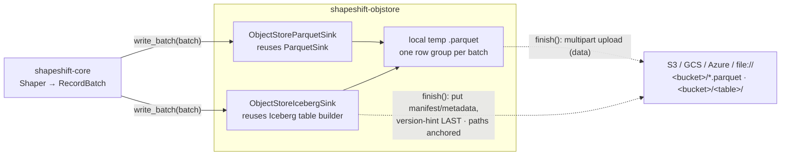

# shapeshift-objstore — the object-store sink

`shapeshift-objstore` lands shapeshift's output in an **object store** — **S3 / GCS /
Azure**, or `file://` — instead of the local filesystem, for **both** sink formats. Each
implements `shapeshift_core::Sink`, so the shaping engine is unchanged; only the
destination moves.

## What it does

- **`ObjectStoreParquetSink`** — a write-once `Sink` targeting an `s3://` / `gs://` /
  `az://` / `file://` URL. It writes the Parquet to a local temp file first (one row
  group per batch, exactly like [`shapeshift-parquet`](../shapeshift-parquet)), then on
  `finish` uploads it: one `PUT` when it fits in 8 MiB, else a **multipart upload** in
  fixed 8 MiB parts — so neither the shape nor the upload ever holds more than a part of
  it in RAM.
- **`ObjectStoreIcebergSink`** — a write-once `Sink` that lands a whole self-contained
  **Iceberg v2 table** (data Parquet + manifest + manifest-list + `metadata.json` +
  `version-hint.text`) under a URL prefix. It reuses
  [`shapeshift-iceberg`](../shapeshift-iceberg)'s backend-agnostic table builder. The data
  files, any delete files, the manifests and the manifest list go up **8 at a time** (with
  at most 16 MiB of file bytes in memory), since nothing names them yet; then the
  `metadata/v{N}.metadata.json` that does — created only if no other writer created it
  (the commit) — and `version-hint.text` last. A failed upload or a refused commit removes
  everything the write put. Every embedded path is **anchored at the destination URI**, so
  DuckDB `iceberg_scan('s3://…')` reads the table back in place.
- **`inspect_iceberg`** — read an object-store table's current metadata (via
  `version-hint.text`) and summarize it: the remote analog of
  `shapeshift_iceberg::inspect`.
- **`is_object_url`** — the scheme check the CLI uses to route a URL `--output` here.
- **Credentials** come from the standard `AWS_*` / `GOOGLE_*` / `AZURE_*` environment
  variables (the `object_store` builders' `from_env()`); nothing is logged or stored.

## Architecture

Both sinks reuse the *local* writers and add a remote-landing tail — the engine never
changes, only the destination. Parquet is one object; an Iceberg table is five objects
whose cross-references are anchored at the destination location, so the table is valid at
its bucket prefix (a server-less Hadoop-style catalog layout).



## Event flow — `create` → `write_batch`\* → `finish` (Iceberg)

The Parquet flow is the same up to `finish`, where it uploads a single object. The Iceberg
sink uploads its files together, then commits the metadata file, then the hint:

```mermaid
sequenceDiagram
    participant CLI as shapeshift-cli
    participant Sink as ObjectStoreIcebergSink
    participant DW as IcebergDataWriter (temp)
    participant Store as object_store backend

    CLI->>Sink: create(dest_url, schema, compression)
    Note over Sink: validate URL + scheme, build the store (credentials<br/>resolve lazily — a bad one surfaces on the first request)
    loop each batch
        CLI->>Sink: write_batch(batch)
        Sink->>DW: write_batch — one row group
    end
    CLI->>Sink: finish()
    Sink->>DW: close — Parquet footer + row count
    Note over Sink: build manifest / manifest-list / metadata,<br/>every path anchored at dest_url
    par 8 at a time
        Sink->>Store: put — data/<uuid>.parquet (multipart past 8 MiB)
        Sink->>Store: put — manifest(s), manifest-list
    end
    Sink->>Store: put if absent — metadata/vN.metadata.json (the commit → snapshot visible)
    Sink->>Store: put — version-hint.text (last; a hint readers look past)
    Sink->>Sink: remove temp file (also on error, via Drop)
    Sink-->>CLI: SinkSummary { files:[metadata_uri], rows, bytes }
```

## Quickstart

Route output to a bucket instead of a local path — the shaping code is identical, only
the destination URL and sink type change:

```rust
use shapeshift_core::{Compression, Sink};
use shapeshift_objstore::{is_object_url, ObjectStoreIcebergSink, ObjectStoreParquetSink};

// `schema` and `batch` come from a shapeshift_core::Shaper.
assert!(is_object_url("s3://my-bucket/events.parquet"));

// A single Parquet object:
let mut pq = ObjectStoreParquetSink::create(
    "s3://my-bucket/events.parquet",
    schema.clone(),
    Compression::Snappy,
)?;
pq.write_batch(&batch)?;
let s = pq.finish()?; // streams the temp Parquet up as a multipart upload
println!("landed {} rows", s.rows);

// …or a whole Iceberg v2 table under a prefix (readable via iceberg_scan('s3://…')):
let mut ice = ObjectStoreIcebergSink::create(
    "s3://my-bucket/db/events",
    schema,
    Compression::Snappy,
)?;
ice.write_batch(&batch)?;
ice.finish()?; // uploads data + manifests + metadata, version-hint last
# Ok::<(), shapeshift_core::ShapeError>(())
```

From the CLI it is a URL `--output` on a build with the `object_store` feature:

```sh
cargo build -p shapeshift-cli --features object_store
AWS_REGION=us-east-1 AWS_ACCESS_KEY_ID=… AWS_SECRET_ACCESS_KEY=… \
  shapeshift shape --input events.jsonl --output s3://my-bucket/db/events --to iceberg
shapeshift inspect s3://my-bucket/db/events   # summarize the table in the bucket
```

## Why a separate crate (and off by default)

`object_store` pulls the cloud SDKs (reqwest, TLS, provider clients) — not
musl-static-clean and not wanted in the lean default `shapeshift` binary. The CLI
depends on this crate **only behind an off-by-default `object_store` feature**, so the
default build never links any of it (CI asserts its absence). The async `object_store`
API is bridged to shapeshift's sync `Sink` on a small current-thread runtime, at
finalize time only.

## v0.1 scope

Both **Parquet** and **Iceberg v2** land in an object store, verified end-to-end with
DuckDB `iceberg_scan('file://…')` (identical to the local path). Tables are
**location-anchored** (absolute paths) — valid and readable at the prefix they were written
to, and still **readable after a move/copy** via `iceberg_scan('<new path>',
allow_moved_paths=true)`. `relocate_iceberg` re-anchors a moved or copied table where it now is,
so any engine reads it with no flag (the same rewrite as a local table's; the files a snapshot
reads are checked against one listing of the prefix first).
