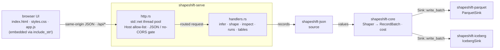
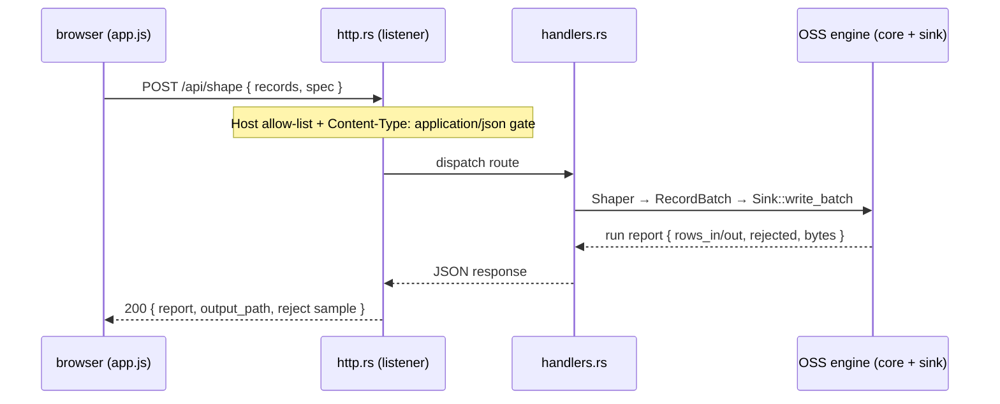

# shapeshift-serve

A tiny **local web console** for the shapeshift shaper. `shapeshift serve` starts an
HTTP server that puts a browser UI in front of the CLI's verbs — **infer** a spec from
sample JSON, **shape** JSON/JSONL into Parquet or an Apache Iceberg v2 table, and
**inspect** the output (pricing a run is `shapeshift cost`, or the website's calculator). Two
read-only views show what happened: **Runs** (every run this console started, its phases
and outcome) and **Tables** (a table's history, read from its own Iceberg metadata).
**Datasets** keep named specs that run on demand (**Run now**), and the **Overview** says
which of them need a look: a failed run, a lost race (exit 75), or no successful run within a
dataset's freshness window. **Alerts** turn those into incidents and tell webhooks: once when
one opens, once when it resolves.

It is deliberately lean: a
*shaper* console, not a control plane. Single-user, keeping nothing beyond the files it
writes, its datasets (`datasets/`), alert rules (`alerts.json`), push connectors
(`connectors.json`, `spool/`) and the log of its own runs (`runs.jsonl`), with **no
scheduler, run queue, catalog server, metering, or auth** on the console. A
dataset runs when you press Run now, or when one of its connectors has a batch ready, one run of
it at a time. The rest is orchestration, out of scope here.

**A dataset can pull**, when the console is started with `--allow-sources`. Its input may be
a source its spec names (`source.http`, an endpoint; `source.mysql` or `source.postgres`, a
database) instead of a file, in a build with the CLI's `http`, `mysql` or `postgres`
feature. **Run now** then reads from the position its table records, and commits the rows
and the new position together, as `shapeshift shape` does. The dataset page shows what it
reads, the position its table records now, and what the last pull read: new, re-read, and
already read. An incremental source's table appends or merges; replacing it would drop the
position, so that is refused. Credentials come from the console's environment, as they do
for the CLI.

**Why `--allow-sources` is off by default.** A spec's source names a host to connect to and
the environment variables whose values it sends there (a token, a password). The console has
no login: whoever can reach it can save a spec, so with sources allowed they could point the
console's credentials at a host of their own. Start it with `--allow-sources` only where
nobody else reaches it (the default loopback address), and give its environment only the
credentials its datasets need.

**Connectors** take records pushed to them. With `--ingest-addr`, a second listener serves
`POST /v1/ingest/<connector>` and nothing else; every post carries the connector's token
(`Authorization: Bearer ssi_…`, shown once, kept as a SHA-256). The body is NDJSON, a JSON
array of objects, or one object, up to 4 MiB, taken whole or refused (400 names the bad line).
A retry that names itself (`Idempotency-Key`, `ce-id`, `x-dagron-event-id`) with the same id and
the same body is taken once (the last 4096 per connector, in memory: a restart forgets them).
Records are appended to the connector's spool and synced before the `202`; the spool is sealed
into a batch at `flush_bytes` or `flush_seconds` and landed by the connector's (Iceberg)
dataset; each batch appends, under its own run id, so a batch run again after it landed adds
nothing. A batch that fails is kept and tried again a minute later; past four times
`flush_bytes` waiting, posts get `503` with `Retry-After`.

The ingest listener speaks **plain HTTP**: a token and its records cross the network as they
are. Off loopback, put a TLS-terminating proxy in front of it (and give producers its
`https://` URL), or keep producers on a network you trust. `serve` says so when it starts.

**Metrics** are off unless asked for. With `--metrics-addr`, a third listener serves
`GET /metrics` and nothing else, in the Prometheus text format; without it no counter is
kept, and nothing is ever sent anywhere. What happens as it happens is counted: runs as they
end, alert evaluations and deliveries, requests answered. What the console's stores hold is
read when the scrape asks, so it is what the pages show.

| Area | Metrics |
|---|---|
| Runs | `shapeshift_runs_total{dataset,via,outcome}` (`via`: shape, dataset, connector); `shapeshift_run_duration_seconds{via}` (a histogram); `shapeshift_rows_total{dataset,kind}` (in, out, rejected); `shapeshift_runs_running` |
| Datasets | `shapeshift_datasets`; `shapeshift_dataset_last_success_timestamp_seconds{dataset}` (of the runs the log keeps); `shapeshift_dataset_freshness_window_seconds{dataset}`; `shapeshift_attention{kind}` (what the Overview lists: run_failed, run_conflict, table_stale) |
| Alerts | `shapeshift_alert_incidents_firing{kind}`; `shapeshift_alert_deliveries_total{result}`; `shapeshift_alert_evaluations_total` |
| Connectors | `shapeshift_ingest_posts_total{connector,result}` (accepted, duplicate, refused); `shapeshift_ingest_records_total{connector}`; `shapeshift_ingest_spool_bytes{connector}`; `shapeshift_ingest_waiting_batches{connector}`; `shapeshift_ingest_oldest_record_age_seconds{connector}`; `shapeshift_ingest_batch_runs_total{connector,result}` |
| Sources | `shapeshift_source_pulls_total{dataset,kind,result}`; `shapeshift_source_records_total{dataset,kind}` (new, replayed); `shapeshift_source_position_timestamp_seconds{dataset}` (when the cursor is a time) |
| Process | `shapeshift_http_requests_total{listener,class}` (console, ingest, metrics); `shapeshift_uptime_seconds`; `shapeshift_build_info{version,features}` |

Labels are the names of datasets and connectors the console keeps, and fixed words, never a
path, a URL or anything read from the data. A run posted to `/api/shape` names its dataset in
the request, so those runs share the label `dataset="(adhoc)"`: a caller cannot mint label
values. Past 500 label sets a metric folds new ones into `other`. Counters start again when the console restarts, as every Prometheus counter does;
the connector counts are the ones its page shows, which a restart resets too. The listener
asks no login: anyone who reaches it reads dataset and connector names and counts, so keep
it on loopback or a network you trust (`serve` says so when it binds elsewhere). On loopback
it answers loopback names only (`localhost`, `127.0.0.1`, `::1` in `Host`), so a page that
rebinds a name of its own to the address reads nothing. A scrape that cannot read the counts
fails with 500 rather than answering empty.

## Single static binary, no runtime

In keeping with shapeshift's ethos (a musl-static single binary, the hand-rolled
Avro encoder), this crate adds **no runtime dependency**:

- The HTTP server is **hand-rolled on `std::net`** — a fixed pool of threads over a
  shared listener. No async runtime (no tokio), no web framework (no axum), and no TLS on
  the server side.
- Alerts are delivered with `ureq` over rustls, with Mozilla's roots bundled
  (`webpki-roots`): HTTPS webhooks work on a box with no CA store. rustls brings ring, the
  one C dependency, which links statically.
- The UI is **three static files** (`ui/index.html`, `ui/styles.css`, `ui/app.js`)
  **embedded into the binary** at compile time with `include_str!`. No Node, no
  bundler, no CDN — the page fetches nothing off-box (enforced by a strict CSP).

So `shapeshift serve` is still one relocatable file with no JVM/Node/Python at
runtime, and the console is compiled *out* of the default build entirely — it lives
behind the CLI's off-by-default `serve` feature.

## Architecture

`shapeshift serve` is a thin HTTP shell over the same OSS engine the CLI drives. The
hand-rolled `std::net` server (`http.rs`) accepts a connection on a fixed thread pool,
applies the `Host` allow-list and the JSON / no-CORS gate, then hands the request to a
route in `handlers.rs`; each route wraps one engine verb one-to-one. The browser UI is
three static files embedded into the binary, so the page fetches nothing off-box.



## Event flow — a `shape` request

Submitting the form POSTs the pasted records plus the edited `DatasetSpec` to
`/api/shape`. The server gates the request, runs it through the engine exactly as the
CLI's `shape` verb would, and returns the run report the UI renders.



## Quickstart

```sh
# Build the CLI with the console compiled in, then start it.
cargo build --release -p shapeshift-cli --features serve
shapeshift serve                       # → http://127.0.0.1:8087/
shapeshift serve --addr 0.0.0.0:8087 --data-dir /var/lib/shapeshift
```

| Flag | Default | Meaning |
|---|---|---|
| `--addr` | `127.0.0.1:8087` | Address to bind. |
| `--data-dir` | `shapeshift-data` | Where shaped output, reject sidecars, and temp input land. |
| `--allow-host <h>` | — | Extra `Host` header to accept (repeatable), for a hostname behind a proxy. |
| `--allow-any-host` | off | Disable the `Host` allow-list (only behind a trusted proxy). |
| `--catalog <uri>` | off | A REST catalog for the Catalog page to browse, read-only (a build with `object_store`); credentials from `SHAPESHIFT_CATALOG_TOKEN` or `SHAPESHIFT_CATALOG_CREDENTIAL`. With `--warehouse` and `--insecure-catalog` as for `shape`. |
| `--ingest-addr` | off | Where connectors take pushed records: a second listener serving only `POST /v1/ingest/<connector>`, token required. |
| `--metrics-addr` | off | Where `GET /metrics` is served (that path only), in the Prometheus text format. Off: nothing is counted. |

## Security

This is a **local tool with no application-level authentication** — keep it bound to
loopback, or front it with your own auth/proxy if you expose it. Two lightweight
gates guard the browser attack surface:

- **`Host`-header allow-list** (loopback names + the bind IP by default) — a
  DNS-rebinding guard: a page on another origin that rebinds to the server's IP still
  carries its own `Host` and is rejected (`403`).
- **`Content-Type: application/json` required on POST**, and **no CORS headers are
  ever sent** — so a cross-origin page cannot forge a state-changing request (it would
  need a CORS preflight the server never approves).

## API

Same-origin JSON, wrapping the OSS engine one-to-one:

| Method + path | Does |
|---|---|
| `GET /api/health` | liveness + version + data dir |
| `POST /api/infer` | sample records → an editable `DatasetSpec` (YAML) |
| `POST /api/shape` | records + spec → run report, output path, reject sample, drift report (`on_drift` picks the policy); a spec's `output.merge_on` upserts into the table; a spec's `where` takes only the records it keeps (`filtered` counts the rest; `type_mismatches` and `first_mismatch` report comparisons of different kinds, which are never true) |
| `POST /api/inspect` | a path → Parquet / Iceberg schema + row count (an Iceberg table's live rows after position deletes, too) |
| `GET /api/runs` | the runs this console started, newest first (its log keeps the newest 500 and any still running): phases (start and end), outcome (`running`, `ok`, `conflict`, `failed`, `interrupted`), exit status, counts, error |
| `GET /api/tables` | the Iceberg tables under `outputs/`: rows, files, snapshots, last change |
| `POST /api/table` | a table path → its history as events (`shapeshift_iceberg::table_events`), schema, partitioning |
| `GET /api/overview` | figures (datasets, runs and failures in 24 h, running, tables), what needs a look (`run_failed`, `run_conflict`, `table_stale`), the latest runs |
| `GET /api/datasets` | every dataset: its definition, latest run, last success, freshness (`fresh`, `stale`, `unwatched`) |
| `POST /api/dataset` | `{name}` → the dataset, its runs (newest 50), its rejects file, whether its table exists, and for a pulled source `source`: its kind, what it reads, the position its table records, and the last pull's counts |
| `POST /api/dataset/run` | `{name}` → the run's result, as `/api/shape` answers; a pulled source's run adds `source`: `kind`, `from` and `position` (the position it started from and committed), `new`, `replayed`, `already_read` |
| `POST /api/dataset/save` | a dataset (`name`, `input_path`, `format`, `to`, `compression`, `append`, `partition_by`, `on_drift`, `freshness_minutes`, `spec_yaml`) → kept as `datasets/<name>.json`; refused (400) if it could not run |
| `POST /api/dataset/run` | `{name}` → runs it now, as `/api/shape` would; 409 while it is running already |
| `POST /api/dataset/rejects` | `{name}` → the latest run's rejected rows (the first 200) and how many |
| `POST /api/dataset/delete` | `{name}` → forgets it; its output and runs stay |
| `GET /api/alerts` | rules, targets (URLs shown as scheme and host only), incidents (firing first) |
| `POST /api/alerts/rule/save` | a rule (`id` to replace; `name`, `kind`, `dataset`, `threshold` for `rejects_over`, `targets`, `enabled`); a rule that changes what it watches resolves its incidents |
| `POST /api/alerts/rule/delete` | `{id}` → its firing incidents resolve without a notice |
| `POST /api/alerts/target/save` | a target (`id` to edit; `name`, `kind` `webhook` or `slack`, `url`, kept when absent on an edit); the URL is never echoed |
| `POST /api/alerts/target/delete` | `{id}` → refused (409) while a rule tells it |
| `POST /api/alerts/target/test` | `{id}` → sends a test notice now; answers the delivery (`ok`, `status`, `error`) |
| `POST /api/alerts/incident/resolve` | `{id}` → resolved by hand; quiet until its condition clears |
| `GET /api/catalog` | whether this build can reach a catalog, and with `--catalog` its namespaces (nested ones too) and their tables, each namespace with the error if its tables could not be listed |
| `POST /api/catalog/refresh` | the same as `GET /api/catalog`, listed again now (a listing is otherwise kept for 30 s) |
| `POST /api/catalog/table` | `{levels, name}` → the table as `/api/table` describes a local one, from the metadata the catalog loads, and its metadata file; 404 if there is no catalog or no such table, 500 if this console's catalog settings are wrong, 502 if the catalog refused or did not answer, 501 in a build without `object_store` |
| `GET /api/connectors` | every connector: dataset, token's last four, flush settings, what waits, counts since start, last error; the ingest address |
| `POST /api/connector/save` | `{name, dataset, flush_bytes, flush_seconds}` → made (its token in the answer, once) or changed; an Iceberg dataset only |
| `POST /api/connector/rotate` | `{name}` → a new token (in the answer, once); the old one stops working |
| `POST /api/connector/flush` | `{name}` → seal the spool now, and try a waiting batch now |
| `POST /api/connector/delete` | `{name, discard}` → refused (409) while records wait, unless `discard` |
| ingest listener: `POST /v1/ingest/<connector>` | records (NDJSON, an array, or one object) with `Authorization: Bearer ssi_…` → `202 {accepted}`; a retry → `200 {duplicate}`; `401`, `400`, `413`, `503` + `Retry-After` |

## License

Apache-2.0 — part of the OSS shaper. Copyright © 2026 Nicholas Lu Chee Seng and the
shapeshift contributors.
